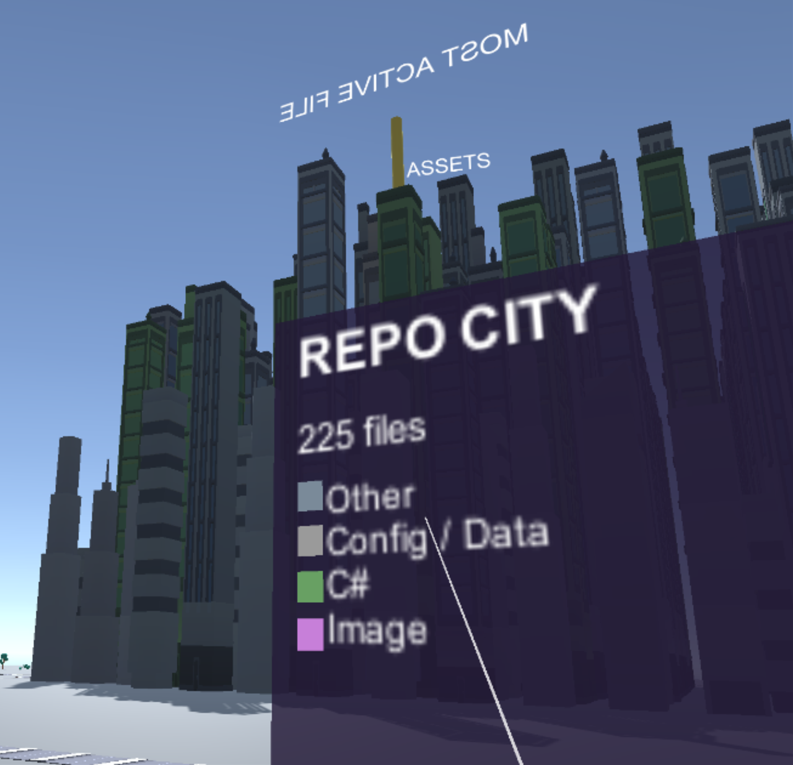
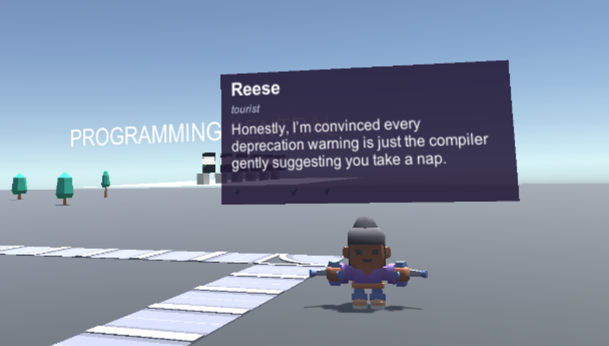
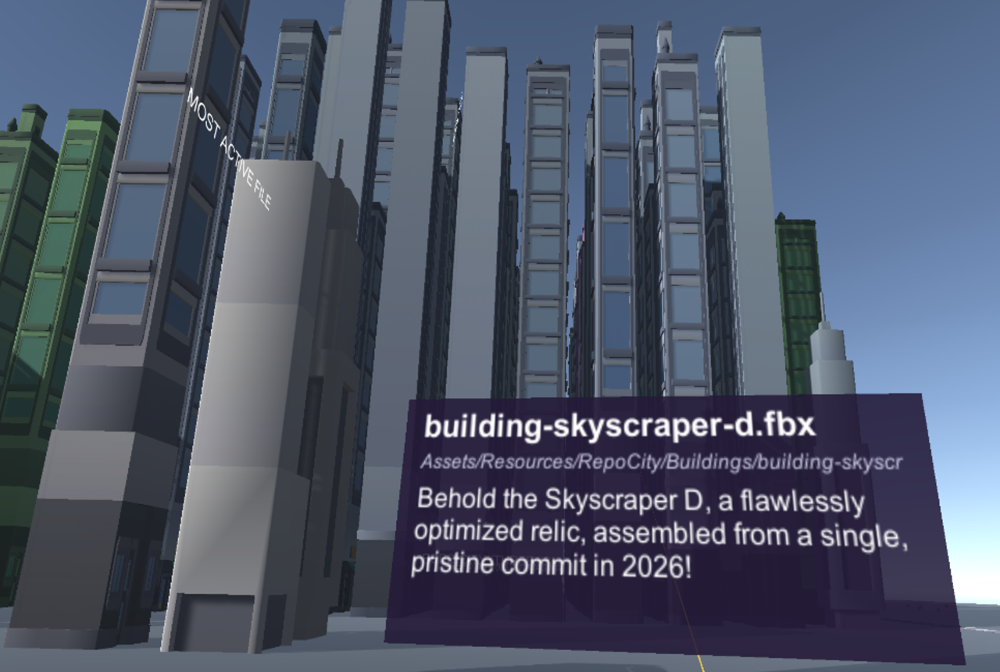
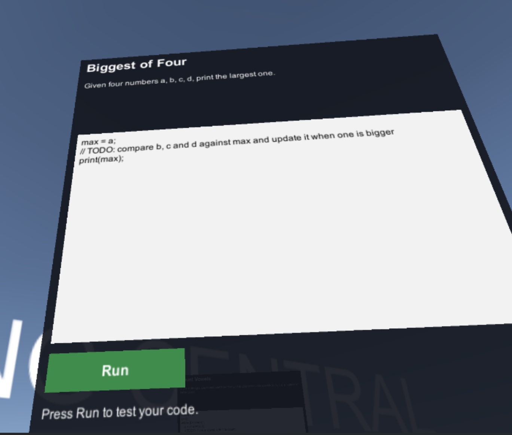
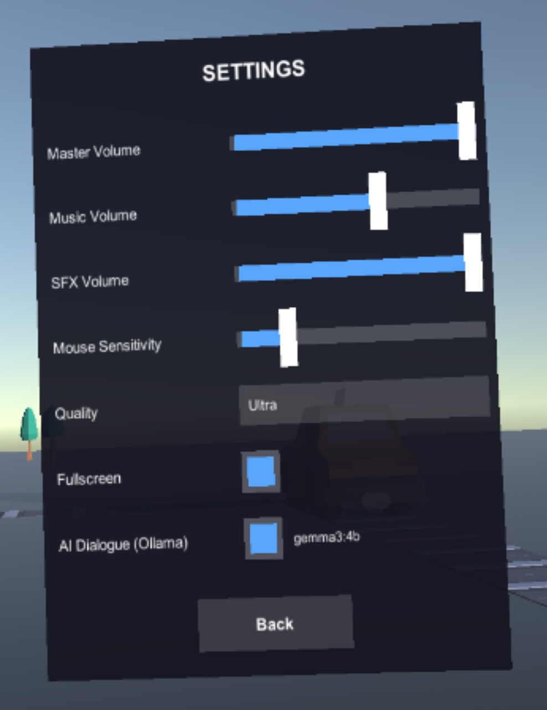

# Repo City VR

Walk through a code repository as a city, in virtual reality.

Every file in a git repository becomes a building. Directories become districts, file size and commit history shape the buildings, and the most active and oldest files get landmark beacons. Several repositories can sit side by side as islands in one world, connected by roads.

The city also has traffic, pedestrians you can talk to, a day/night cycle, and **Programming Central**, an arcade of small coding challenges you solve at in-world kiosks.

## Screenshots



<table>
  <tr>
    <td width="50%"></td>
    <td width="50%"></td>
  </tr>
  <tr>
    <td>Every pedestrian has a personality and something going on in their life. With Ollama running, they talk in character and remember what they told you.</td>
    <td>Every building is a file. Point at one and grip to hear a tour guide describe it.</td>
  </tr>
  <tr>
    <td width="50%"></td>
    <td width="50%"></td>
  </tr>
  <tr>
    <td>Programming Central: solve small coding challenges at in-world kiosks.</td>
    <td>Settings, including the AI dialogue toggle and the model in use.</td>
  </tr>
</table>

## Requirements

- **Unity 6000.6.5f1**, using the Built-in render pipeline with OpenXR.
- **A PC VR headset through SteamVR.** It's developed and tested on an HTC VIVE Pro 2 with Vive wand controllers. The HTC Vive and Valve Index controller profiles are enabled.
- **Optional: [Ollama](https://ollama.com)** running locally. When it's available, NPCs and building narration use it to generate dialogue; without it, they fall back to preset lines. The game uses the first installed model from a preference list, starting with `gemma3:4b` (about 3 GB of video memory, replies in well under a second), and falls back to any installed chat model. Turn it off under **Settings → AI Dialogue** to free the video memory for VR.

The project also runs on desktop without a headset, using keyboard and mouse.

## Getting started

1. Clone the repository and open the folder in Unity Hub with Unity 6000.6.5f1.
2. Start SteamVR with your headset connected. SteamVR must be the active OpenXR runtime.
3. Open `Assets/Scenes/MainMenu.unity` and press Play, or build a Windows player and run it.

The scene order is `MainMenu` → `RepoWorld` (all islands) → `RepoCity`.

## Controls

### VR (Vive wands)

| Input | Action |
| --- | --- |
| Point at a panel + **trigger** | Click buttons. Hold and move to drag sliders. |
| **Trigger** (not on a panel) | Aim the teleport arc. Release to teleport. |
| **Grip** | Talk to the person, or inspect the building, you're pointing at. The pointer beam turns yellow when there's something to talk to or inspect. |
| **Menu button** (above the trackpad) | Pause menu. |
| **Left trackpad click** | Show/hide the wrist minimap. Raise your left hand to read it. |
| **Grip** on the main menu | Recenter the menu in front of you. |

Your hands are drawn on the controllers. The index finger follows the trigger and the other fingers follow the grip.

### Desktop

| Input | Action |
| --- | --- |
| **W A S D** / arrow keys | Move |
| Hold left mouse button + drag | Look around |
| **Esc** | Pause menu |
| **Enter** | Press Play on the main menu |

## Visualising your own repository

The city is built from `Assets/Resources/RepoCity/repo-data.json`. To generate it from a repository, run the script from the root of a git checkout. It needs Node.js 22 or newer, which runs the script's ES-module syntax without a `package.json`. It writes into `Assets/Resources/RepoCity/` under the directory you run it from.

```sh
node scripts/generate-repo-data.js
```

The script reads `git ls-files` and `git log` and writes the file list with sizes, commit counts and last-modified dates. It doesn't read file contents or any author information. Extra islands are listed in `Assets/Scripts/RepoCity/WorldConfig.cs`, each pointing at its own `repo-data.json` under `Assets/Resources/RepoCity/Worlds/`.

## Project layout

- `Assets/Scripts/RepoCity/`: all runtime code. The scenes are built in code by the bootstrappers.
  - `WorldBootstrapper`, `SceneBootstrapper` and `MainMenu` are the scene entry points.
  - `CityLayout`, `CityBuilder`, `WorldBuilder`, `RoadNetwork` and `Landmarks` generate the city.
  - `HeadTracker`, `HandAnchor`, `HandVisual`, `Locomotion` and `VrUiPointer` handle VR tracking, hands, teleport and laser UI.
  - `TrafficController`, `NpcController`, `NpcChat`, `OllamaNarrator` and `OllamaClient` provide the living-city systems. `SpeechBubble` shows NPC lines and narration, and `FaceViewer` turns labels to face the player.
  - `CodeArcadeBuilder`, `CodeKiosk`, `CodeChallenges` and `MiniLang` make up Programming Central and its small interpreted language.
- `Assets/Editor/`: batch-mode setup helpers. `SetupScene` creates the scenes and `SetupXR` configures OpenXR and the controller profiles.
- `scripts/generate-repo-data.js`: repository-to-city data exporter.

## VR notes

These were learned the hard way on real hardware:

- **Rendering:** OpenXR runs in **Multi Pass** with **MSAA off**. With MSAA on, or in Single Pass Instanced, this setup rendered only the skybox in the headset. `HeadTracker` keeps MSAA off at runtime while a headset is active.
- **Head tracking:** the camera is driven by `HeadTracker` instead of a `TrackedPoseDriver`. Each scene recenters you onto its spawn point and facing direction.
- **Testing:** desktop screenshots don't show VR-only problems. Check changes in the headset.

## License

The code is released under the [MIT License](LICENSE). Bundled models and audio are CC0, from [Kenney](https://kenney.nl) and [OpenGameArt](https://opengameart.org); see [`ThirdPartyLicenses/`](ThirdPartyLicenses/).
